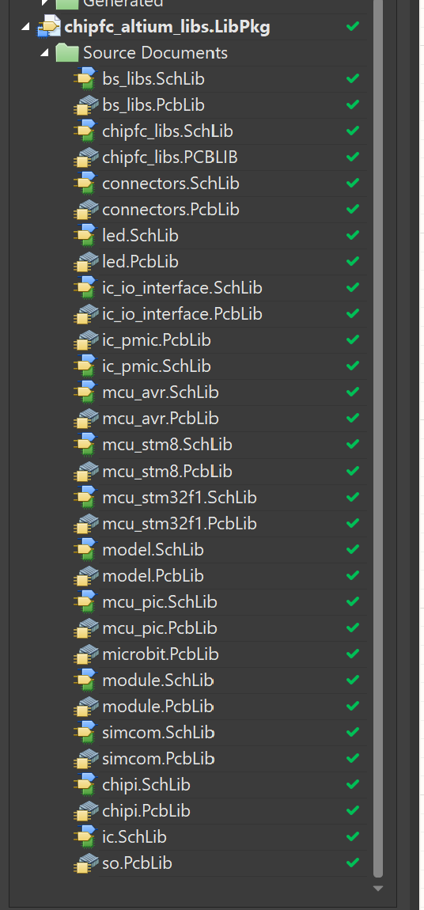
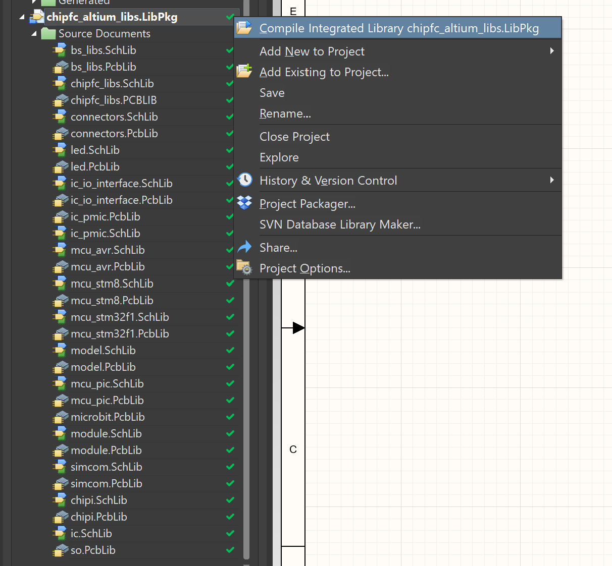
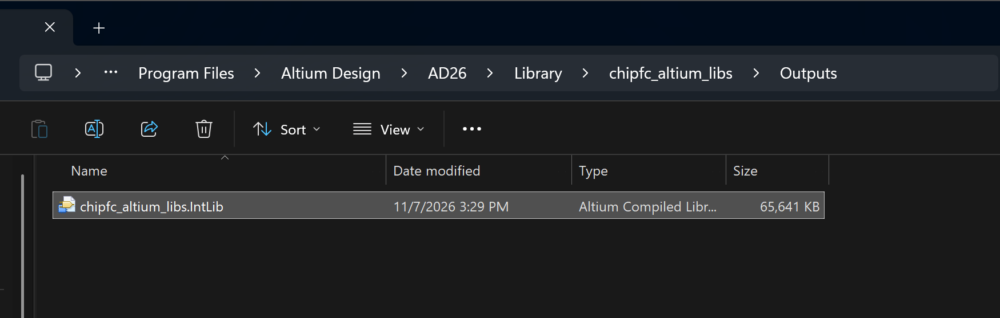
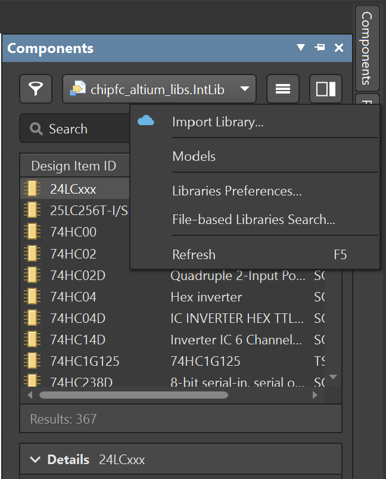
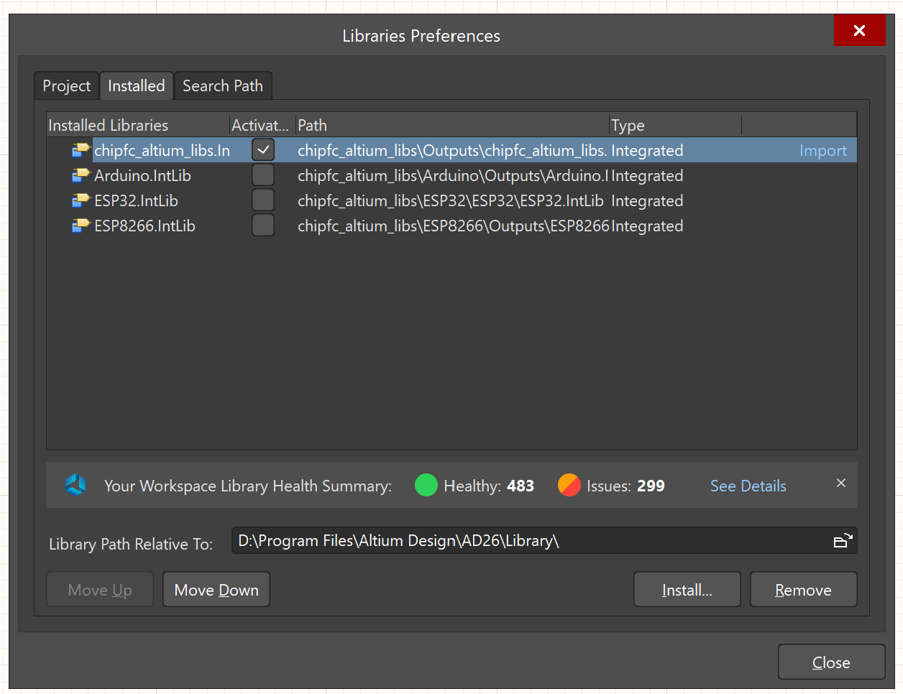

# chipfc_altium_libs

Bộ thư viện linh kiện Altium của ChipFC: 18 thư viện, 385 linh kiện (symbol) và 750 footprint.

Mở `chipfc_altium_libs.LibPkg` để nạp các thư viện chính. `Arduino`, `ESP32` và `ESP8266` không nằm trong gói này, mỗi thư viện có file `.LibPkg` riêng trong thư mục của nó.

## Cài đặt vào Altium

Repo chỉ chứa file nguồn (`.SchLib`, `.PcbLib`). Cách gọn nhất là biên dịch thành một file thư viện tích hợp (`.IntLib`) rồi cài file đó. Footprint của nhiều linh kiện nằm ở thư viện khác (xem [Lưu ý khi dùng](#lưu-ý-khi-dùng)), nên biên dịch cả gói thì symbol và footprint luôn đi kèm nhau.

Ảnh chụp trên Altium Designer 26.

### 1. Mở gói thư viện

Trong Altium chọn **File → Open** và mở `chipfc_altium_libs.LibPkg`. Panel **Projects** sẽ hiện toàn bộ thư viện trong gói.

### 2. Biên dịch thành IntLib

Chuột phải vào `chipfc_altium_libs.LibPkg` và chọn **Compile Integrated Library chipfc_altium_libs.LibPkg**. Sau khi chạy xong, xem panel **Messages** để kiểm tra lỗi.

File kết quả nằm ở `Outputs/chipfc_altium_libs.IntLib`. Thư mục `Outputs` đã được bỏ qua trong `.gitignore`.

### 3. Cài IntLib

Mở panel **Components** (nút **Panels** ở góc dưới bên phải → **Components**), bấm nút ≡ và chọn **Libraries Preferences...**

Ở tab **Installed**, bấm **Install...** và chọn file `.IntLib` vừa tạo. Nhớ tích cột **Activated** cho thư viện cần dùng.

`Arduino`, `ESP32` và `ESP8266` làm tương tự: mở `.LibPkg` trong thư mục của từng thư viện, biên dịch, rồi cài file `.IntLib` tạo ra.

### 4. Đặt linh kiện

Trong panel **Components**, chọn `chipfc_altium_libs.IntLib` ở ô thư viện, gõ tên linh kiện vào ô **Search** rồi kéo vào sơ đồ. Linh kiện có nhiều footprint (ví dụ `Resistor`) thì chọn cỡ ở mục **Footprint** trong panel **Properties**.

### Khi thư viện được cập nhật

`.IntLib` là bản đã biên dịch nên không sửa trực tiếp được. Sau khi `git pull` hoặc sửa `.SchLib`/`.PcbLib`, hãy biên dịch lại như bước 2. File mới nằm ở cùng đường dẫn nên không cần cài lại; nếu panel **Components** chưa cập nhật thì bấm ≡ → **Refresh** (F5).

## Cần linh kiện gì thì mở thư viện nào

| Thư viện | Chứa gì | Linh kiện | Footprint |
|---|---|---:|---:|
| [`chipfc_libs`](#chipfc_libs) | Thư viện chính: linh kiện cơ bản và IC phổ biến | 141 | 333 |
| [`bs_libs`](#bs_libs) | Thư viện bổ sung: cảm biến, RF, nguồn AC-DC, LED địa chỉ, module | 111 | 125 |
| [`connectors`](#connectors) | Header, terminal, USB, RJ45, SMA và các đầu nối khác | 47 | 143 |
| [`led`](#led) | LED đơn, LED 2 màu, RGB, LED 7 đoạn, LED ma trận | 18 | 61 |
| [`ic_pmic`](#ic_pmic) | IC quản lý nguồn: buck, boost, LDO, sạc pin | 13 | 16 |
| [`ic_io_interface`](#ic_io_interface) | IC mở rộng I/O và driver LED | 5 | 5 |
| [`ic`](#ic) | Driver LED 7 đoạn MAX7219 (footprint nằm ở `so.PcbLib`) | 1 | 1 |
| [`mcu_avr`](#mcu_avr) | Vi điều khiển AVR có USB | 4 | 12 |
| [`mcu_pic`](#mcu_pic) | Vi điều khiển PIC | 1 | 1 |
| [`mcu_stm32f1`](#mcu_stm32f1) | Vi điều khiển STM32 (F1, kèm một mã F0) | 7 | 4 |
| [`mcu_stm8`](#mcu_stm8) | Vi điều khiển STM8 | 5 | 3 |
| [`simcom`](#simcom) | Module GSM, 3G, 4G của SIMCom | 9 | 10 |
| [`module`](#module) | Module nguồn AC-DC và module relay | 3 | 4 |
| [`chipi`](#chipi) | Khung board ChipI: cỡ 1x1, 1x2, 2x2; 0, 4 hoặc 6 chân | 4 | 14 |
| [`model`](#model) | Logo ChipFC để đặt lên PCB | 1 | 3 |
| [`ESP8266`](#esp8266) | Module WiFi ESP8266: ESP-01 đến ESP-12-E | 13 | 13 |
| [`ESP32`](#esp32) | Module WiFi + Bluetooth ESP32 | 1 | 1 |
| [`Arduino`](#arduino) | Khung shield Arduino Uno R3 | 1 | 1 |

`microbit.PcbLib` nằm trong thư mục `chipfc_libs`. Đây là 18 footprint lấy từ board micro:bit và không có file symbol riêng.

## Chi tiết từng thư viện

Tên trong dấu `` ` `` là tên tra được trong Altium. Phần trong ngoặc là ghi chú chức năng. Việc chia nhóm dựa trên mô tả lưu trong thư viện và mã linh kiện.

### chipfc_libs

Thư viện chính: linh kiện cơ bản và IC phổ biến.

| Nhóm | Linh kiện |
|---|---|
| Thụ động cơ bản | `Resistor`, `Resistor Array 4`, `Resistor Sip9`, `Resistor Variable` (biến trở), `Capacitor` (tụ có cực), `Capacitor NP` (tụ không cực), `Inductor`, `CDRH103RNP-6R8NC-B` (cuộn cảm 6.8uH 3.6A), `Fuse`, `Crystal`, `Crystal 4pin`, `Battery`, `Buzzer` |
| Diode và bảo vệ ESD | `Diode`, `Diode Dual`, `Diode ESD/TVS`, `Diode Schottky`, `Diode Zener`, `B340AE-13` (Schottky 40V 3A), `CDSOT23-SM712` (TVS), `SMF05C` (TVS 5 đường), `TPD2E001DZDR` (ESD 2 kênh) |
| Transistor, MOSFET, Triac | `Transistor NPN`, `Transistor NPN Darlington`, `Transistor PNP`, `Mosfet N`, `Mosfet P`, `AO4407A` (P-MOS 30V 12A), `FDC6420C` (N+P MOS 20V), `TRIAC` |
| Opto cách ly | `EL354N-G`, `EL3H4-G`, `Opto MOC3020` (kích triac), `Opto PC817B`, `Opto PC900V` |
| IC logic, chuyển mức, analog | `74HC00` (NAND), `74HC02` (NOR), `74HC04` (NOT), `74HC14D` (NOT Schmitt), `74HC238D` (giải mã 3-8), `74HC245` (đệm bus), `74HC245D` (đệm bus), `74HC4053` (mux analog), `74HC595` (thanh ghi dịch), `74LV125` (đệm 3 trạng thái), `HEF4049B` (NOT), `GTL2003` (chuyển mức 8 bit), `PCA9306` (chuyển mức I2C), `TLC555` (timer), `LM358` (op-amp kép) |
| Bộ nhớ, RTC | `24LCxxx` (EEPROM I2C), `AT25DF041A` (Flash SPI 4Mb), `SST25xFxxx` (Flash SPI), `DS1307` (RTC) |
| Vi điều khiển | `ATmega328P-AU`, `MSP430F1612IPM`, `MSP430F2618TPMR`, `MSP430F5529IPN`, `PIC16F1823` |
| USB-UART | `CH340G`, `FT232BL`, `FT232RL`, `PL2303HXD` |
| Giao tiếp RS-232/485, CAN, LIN, Ethernet | `MAX232` (RS-232), `MAX3485EESA+` (RS-485), `MCP2515-SO` (CAN controller SPI), `MCP2551` (CAN transceiver), `TJA1040T` (CAN transceiver), `MCP2021` (LIN transceiver), `E520.3x` (LIN SBC), `DP83848CVV` (Ethernet PHY), `W5100` (Ethernet controller) |
| Nguồn: LDO, buck, boost, giám sát | `78xx`, `AMS1117`, `LP2985-33DBVR`, `MCP17xx`, `MIC29302WT`, `TPS732xx`, `LM2596S-5.0` (buck 3A), `LM25xx` (buck 3A), `MC34063A` (buck/boost), `TPS54xx` (buck), `TLV840CADL29DBVR` (giám sát điện áp) |
| Sạc pin | `BQ2405x`, `MCP73831/2` |
| Driver động cơ, tải | `IR2184` (driver nửa cầu), `L293`, `L298P`, `ULN2003` |
| Cảm biến | `ACS712` (dòng Hall), `MCP9700` (nhiệt độ), `MCP9700AT-ETT` (nhiệt độ), `BMP085` (áp suất), `MPL115A2` (áp suất), `BMA180` (gia tốc), `MMA7260Q` (gia tốc), `MMA7455L` (gia tốc), `MMA845xQ` (gia tốc), `IDG650` (con quay), `IXZ650` (con quay), `ITG3200` (con quay), `HMC5883L` (la bàn), `MPU-6050` (gia tốc + con quay), `IMU GY-86` (module IMU) |
| Không dây, GPS, GSM | `BC04` (Bluetooth), `RN171` (WiFi), `WizFi210` (WiFi), `XBEE`, `TFDU4101` (hồng ngoại IrDA), `GPS L70`, `GPS MT3329`, `GPS NEO-6M`, `M95` (GSM Quectel), `EBOX_3G Module` |
| Màn hình | `GLCD`, `GLCD 2`, `LCD 16x2`, `LCD 8x2`, `LCD Nokia 6100` |
| Relay, công tắc, jumper | `Relay DPDT`, `Relay SPDT`, `Relay SPDT_SLA`, `SS-12D10G5`, `SW 5-way SMD`, `SW DIP-2`, `SW DIP-3`, `SW DIP-4`, `SW DPDT`, `SW SPDT`, `SW SPST`, `JUMP 2`, `JUMP 2 CUSTOM`, `JUMP 2 Open`, `JUMP 3` |
| Socket thẻ, cơ khí, test | `CON SDCard`, `CON SDCard Micro`, `SIM holder 6 pin`, `SIM holder 6p micro`, `SIM holder 8 pin`, `Screw Hole`, `Test Point` |

315 footprint trong <code>chipfc_libs.PCBLIB</code>

`21-0041B_8_MXM`, `21-0041B_8_MXM-L`, `21-0041B_8_MXM-M`, `BC04`, `BUZZER`, `Buzzer SMD`, `BUZZER-2`, `C 0402`, `C 0402 PNP`, `C 0603`, `C 0805`, `C 104`, `C 1206`, `C 1210`, `C 1210 mix 0805`, `C Ceramic`, `C SMD ALU (B)`, `C SMD ALU (D)`, `C SMD ALU (D8)`, `C SMD ALU (D8) DUAL`, `C SMD ALU (F)`, `C SMD ALU (F) DUAL`, `C SMD ALU (G)`, `C SMD TAN 1206 (A)`, `C SMD TAN 1210 (B)`, `C SMD TAN 2312 (C)`, `C SMD TAN 2917 (E)`, `C Super 414-VA5R`, `C Super Case A`, `C Super Case B`, `CAP Ceramic/D7.0/F7.5`, `CAP Ceramic/W200`, `CAP Ceramic/W300`, `CAP Ceramic/W550`, `CAP/D100/H125/LS50`, `CAP/D100/H200/LS50`, `CAP/D80/H125/LS30`, `CAP/D80/H125/LS35`, `CAP/D80/H90/LS35`, `CHOKE`, `CHOKE CYL D350`, `CHOKE CYL D400`, `CON Batttery BL-5C`, `CON CR1220`, `CON CR2032`, `CON PS/2 FEMALE`, `CON RCA`, `CON SD`, `CON SD Micro`, `CON SIM Holder 47548`, `CON SIM Holder 6 pins`, `CON SIM Holder C707`, `CON SIM Holder FMS006-2600`, `CON SIM Holder I9000`, `CON SIM Micro 6P PUSH`, `CR_SMA_320-340AE_DIO`, `CR_SMA_320-340AE_DIO-L`, `CR_SMA_320-340AE_DIO-M`, `Crystal 3215`, `Crystal DIP-2`, `Crystal HC49S DIP`, `Crystal HC49US SMD`, `Crystal SMD 4PIN 25x20`, `Crystal SMD 4PIN 32x25`, `Crystal SMD 4PIN 50x32`, `Crystal SMD 9H T10`, `CYL/D.200/LS.75`, `CYL/D.200/LS.75-D50H110P20`, `CYL/D.200/LS.75-D50H70P20`, `CYL/D.250/LS.100`, `CYL/D.250/LS.100-D63H112P25`, `CYL/D.250/LS.100-D63H70P25`, `CYL/D.250/LS.100/.031`, `CYL/D.300/LS.150`, `CYL/D.300/LS.150/.031`, `CYL/D.350/LS.200/.034`, `CYL/D.400/LS.200`, `CYL/D.400/LS.200/.031`, `CYL/D.500/LS.200`, `CYL/D.600/LS.300/.039`, `CYL/D.650/LS.300`, `DBV0005A-IPC_A`, `DBV0005A-IPC_B`, `DBV0005A-IPC_C`, `DBV0005A-MFG`, `DHT11_nam ngang`, `DIODE BRIDGE DIP 1AMP`, `DIODE DIP 2AMP`, `DIODE DIP 3AMP`, `Diode PowerDI123`, `Diode SOD-123`, `Diode SOD80C Reflow`, `Diode SOD80C Wave`, `DIP 14`, `DIP 16`, `DIP 18`, `DIP 20`, `DIP 28`, `DIP 4`, `DIP 40`, `DIP 6`, `DIP 8`, `DO-214AA (SMB) L`, `DO-214AB (SMC)`, `DO-214AC (SMA)`, `DO-214AC (SMA) L`, `DO-219AB (SMF)`, `DO-27`, `DO-35 (SOD27 )`, `DO-41`, `Domino 2 - Short`, `EBOX_3G`, `Fuse 1812P050`, `FUSE 2 DIP - KSD 9700`, `FUSE 2 DIP 0520 BOX`, `FUSE 4 DIP`, `FUSE 4 DIP 0520`, `FUSE 4 DIP 0520 BOX`, `GLCD YM12864J`, `GPS L70`, `GPS MT3329`, `GPS NEO-6`, `IC BMA180`, `IC BMP085`, `IC HMC5883`, `IC IDG650`, `IC ITG3200`, `IC MAX7456`, `IC MMA7260Q`, `IC MPL115`, `IMU GY-86`, `IND_CDRH103R_SUM`, `IND_CDRH103R_SUM-L`, `IND_CDRH103R_SUM-M`, `IND_MWSA0518_525418`, `Inductor SMD 0805 (2012)`, `Inductor SMD 10x10x3.8`, `Inductor SMD 1210 (3225)`, `Inductor SMD 12x12x8`, `Inductor SMD 12x12x8 mix`, `Inductor SMD 4.8x4.8`, `Inductor SMD 6.5x6.5x3.0`, `Inductor SMD 7.5x7.0x5.0`, `Inductor SMD 8.3x8.3x4.5`, `Inductor SMD CDRH3D48`, `Inductor SMD CDRH3D67`, `Inductor SMD CDRH8D43`, `JUMP/2/Close`, `JUMP/2/Custom`, `JUMP/2/Custom2`, `JUMP/2/Open`, `JUMP/2/SMD/0402`, `JUMP/2/SMD/0603`, `JUMP/2/SMD/0805`, `JUMP/2/SMD/C`, `JUMP/2/SMD/D`, `JUMP/2/SMD/E`, `JUMP2 SMD`, `JUMP3`, `JUMP3 SMD`, `L 0402`, `L 0402 PNP`, `L 0603`, `L 0805`, `L 0805 (2012)`, `L 1008`, `L/D8H10`, `L/D9H12`, `LCD 1602A`, `LCD 1602B`, `LCD 16x2`, `LCD 8x2`, `LCD NOKIA 6100`, `LGA-14`, `M95`, `M95 2`, `MMA845xQ`, `PowerSO20`, `QFN 40P 10N`, `QFN 50P 24`, `QFN 50P 24 400X400X95`, `QFN 50P 32`, `QFN 65P 20`, `QFP 40P 80`, `QFP 50P 100`, `QFP 50P 48`, `QFP 50P 64`, `QFP 50P 80`, `QFP 80P 32`, `QFP 80P 44`, `R 0402`, `R 0402 PNP`, `R 0603`, `R 0805`, `R 1/2W/630`, `R 1/4W`, `R 1/4W - A`, `R 1/4W/300`, `R 1206`, `R 1210`, `R 1812`, `R 1W`, `R 1W/500`, `R 1W/790`, `R 2010`, `R 2512`, `R 5W`, `R Photo A`, `R Photo B`, `R SIP9`, `R Var 3mm`, `R VAR A`, `R VAR A 3D`, `R VAR B`, `R VAR C`, `R VAR D`, `R VAR E`, `R Var Volum`, `R Var Volum right`, `RA4 1206 (3216)`, `RES_1W_V`, `RL_DPDT_1A`, `RL_DPDT_5A`, `RL_SPDT_10A`, `RL_SPDT_20A_SMALL`, `RL_SPDT_30A`, `RL_SPDT_MIX`, `RN171`, `SCREW/2.8/5.0`, `SCREW/3.0/6.0`, `SCREW/3.2/7.0/M`, `SOCKET/SD/9`, `SOCKET/SD/BIG`, `SOD123`, `SOD323`, `SOD523F`, `SOD523L`, `SOD80C Reflow`, `SOD80C Wave`, `SOIC-14`, `SOIC-16`, `SOIC-20`, `SOIC-28`, `SOIC-8`, `SOIC-8 EP`, `SOIC127P600X175-8N`, `SOP4 - EL354N`, `SOT-143B`, `SOT-223`, `SOT-223-5`, `SOT-23`, `SOT-23-5`, `SOT-23-6`, `SOT-23_MC_MCH`, `SOT-23_MC_MCH-L`, `SOT-23_MC_MCH-M`, `SOT-363-6`, `SOT-89`, `SOT108-1_NXP`, `SS-12D10G5_XKB`, `SSOP4 - EL3H4`, `SW 5-WAY SMD`, `SW 5-WAY SMD 2`, `SW/2/DIP`, `SW/2/DIP Edge`, `SW/2/DIP/Edge/4.5mm`, `SW/2/SMD`, `SW/2/SMD LY-A03-03`, `SW/2/SMD/Micro`, `SW/3/SPDT/POWER`, `SW/3/SPDT/SS12D06`, `SW/3/SPDT/SS12D10`, `SW/4/DIP`, `SW/4/DIP/SMALL`, `SW/4/SMD`, `SW/4/SMD/SMALL`, `SW/4/SMD/XS`, `SW/5/SPDT/MEDIUM`, `SW/5/SPDT/SMALL`, `SW/6/DPDT`, `SW/DIP2`, `SW/DIP3`, `SW/DIP4`, `SW/DIP6`, `SW/DIP8`, `SW/DPDT/10MM`, `TESTPOINT/1/Black`, `TESTPOINT/1/Blue`, `TESTPOINT/1/Brown`, `TESTPOINT/1/Gray`, `TESTPOINT/1/Green`, `TESTPOINT/1/Orange`, `TESTPOINT/1/Red`, `TESTPOINT/1/Violet`, `TESTPOINT/1/White`, `TESTPOINT/1/Yellow`, `TESTPOINT/DIP`, `TestPoint/SMD/1.5mm`, `TestPoint/SMD/2mm`, `TestPoint/SMD/3mm`, `TFDU4101`, `TO-126`, `TO-220`, `TO-220-5`, `TO-220/HeatSink`, `TO-252 (DPAK)`, `TO-263 (D2PAK)`, `TO-263-5`, `TO-92`, `TSSOP 20 65P`, `TSSOP 28 65P`, `TSSOP 28 65P EP`, `WizFi210`, `XBEE`, `XBEE Pro`

18 footprint trong <code>microbit.PcbLib</code>

`ANTENMICROBIT`, `C 0402`, `CONN/USB/MICRO/RA/H`, `L 0402 (1005)`, `LED 0603 - RED`, `LED 0603 - YELLOW`, `LGA-12`, `MICROBIT_KHUNGVIEN_3`, `PH2-0-2PWB`, `Q-SMD4PAD`, `QFN-32`, `QFN-48-T`, `R 0402`, `SOD-323`, `SOT-886`, `SW/4/SMD`, `TestPointLongPad`, `TestPointSmall`

### bs_libs

Thư viện bổ sung: cảm biến, RF, nguồn AC-DC, LED địa chỉ, module.

| Nhóm | Linh kiện |
|---|---|
| Cảm biến nhiệt, ẩm, khí | `DTH11` (DHT11, thư viện viết sai thành DTH11), `LM35DMX`, `LM35DZ`, `MLX90614` (nhiệt độ hồng ngoại), `MQX` (cảm biến khí dòng MQ) |
| Cảm biến quang, hồng ngoại | `ITR20001/T`, `RPR-220`, `SFH9201-Phototransistor`, `ST188`, `LS06 - Light Sensor`, `Photoresistor` (quang trở), `PIR Sensor`, `Si114x` (tiệm cận/UV/ánh sáng), `TSOP17xx` (thu IR), `TSOP18xx` (thu IR), `Wii IR Camera` |
| Cảm biến dòng | `Current Sensor`, `TA12`, `TA12L`, `TA17`, `TA20-100`, `TA8351` (chưa rõ, xếp theo tên) |
| Y sinh | `AD8232` (điện tim ECG), `MAX3010X` (nhịp tim, SpO2) |
| Âm thanh | `Micro`, `SPU0410LR5H-QB` (mic MEMS), `CMT-8530S-SMT` (loa buzzer SMD), `LM386` (khuếch đại audio), `MT8870Dx-18PIN` (giải mã DTMF), `UM66T-xxL` (tạo nhạc), `WT5001M02-28P` (module phát âm thanh) |
| Không dây, RF, anten | `CC2540` (BLE), `CC2541` (BLE), `nRF24L01` (RF 2.4GHz), `MFRC522` (RFID 13.56MHz), `RF/PT2272/4D` (module RF 315/433MHz), `XBEE Package`, `GPS L70`, `AN6520` (anten chip 2.4GHz), `Antenna PCB 2.4GHz 50ohm`, `J SMA CONN` |
| IC logic, nhớ, giao tiếp, analog | `25LC256T-I/SN` (EEPROM SPI 256K), `74HC02D`, `74HC04D`, `74HC1G125`, `74LVC1G14`, `TXB0102DCUR` (chuyển mức), `MAX485` (RS-485), `LM321` (op-amp), `MCP601-5P` (op-amp) |
| Vi điều khiển, board | `ATmega8A-AU`, `RaspberryPi` |
| Driver động cơ, MOSFET, Triac | `DRV8833` (driver DC), `GY-4988` (module driver bước), `IR2101` (driver nửa cầu), `IR2184` (driver nửa cầu), `ULN2803`, `IRF540NPBF` (N-MOS 100V 33A), `IRF9540NPBF` (P-MOS 100V 23A), `IRF7832` (N-MOS 30V 20A), `IRLM6402` (P-MOS), `Triac BTxxx` |
| Opto cách ly | `PC817`, `SFH6286`, `MOC304x` (kích triac) |
| Nguồn, sạc | `LM2576SX-5.0` (buck 5V 3A), `TPS6103x` (boost), `TNY25x` (switcher offline), `TP4056` (sạc Li-ion), `TP5100` (sạc Li-ion), `AC-DC 12V3A` (module AC-DC), `AC Soket Panasonic` (ổ AC), `Trans 4-PIN`, `Trans 6-PIN`, `Choke filter`, `Power Inductor`, `SuperCap`, `DIODE BRIDGE`, `PDS1040L` (Schottky 40V 10A), `Varistor`, `Sense Resistor` |
| LED, màn hình | `WS2812`, `WS2813`, `SK6812`, `LPD6803` (driver LED), `TM1637` (driver LED), `GLCD5110`, `OLED-091-15P-SSD1306`, `OLED-096-30P-SSD1306` |
| Jack, socket | `HDMI Type A`, `Jack Phone Stereo 3p`, `Jack Phone Stereo 3p S`, `Jack Video 2`, `Battery Connector iPhone 4 FPC`, `SIM holder 6 pin ASMFS180B10BR008` |
| Nút, joystick, cảm ứng, relay | `Joystick PS2  Thumb`, `SW 22D18G2`, `SW DIP-5`, `SW DIP-8`, `SW SPST 4-pin`, `Touch pad`, `Touch pad 2`, `TTP223-BA6` (IC cảm ứng 1 phím), `RELAY 8P LY2 OMRON`, `RELAY 8P OMRON` |
| Thụ động, cơ khí | `Crystal 4p`, `Resistor Array x4`, `Resistor Bar`, `HEX-M3`, `R1.25-3.5S`, `Shield cover` |

125 footprint trong <code>bs_libs.PcbLib</code>

`AC Socket Panasonic`, `AC-DC 12V1A`, `AC-DC 12V2A`, `AC-DC 12V3A`, `AN6520`, `Antenna PCB 2.4GHz 50ohm`, `BB-BAT-18650-x1`, `Buzzer SMD`, `C Super 414-VA5R`, `CON iPhone 4 Battery`, `CON SIM Holder ASMFS180B10BR008`, `CON SIM Holder LCN`, `CR2032`, `CR2450`, `CR2450 DIP`, `CUI_CMT-8530S-SMT`, `Current Sensor 18mm`, `Diode Mini-MELF`, `Diode powerdi5`, `Diode SOD-123/CASE 425-04`, `Diode Zenner Small`, `DiodeBridge-DB1S`, `DiodeBridge-SOIC4`, `DIP-6 Black`, `DIP4 - PC817`, `DLW5BT`, `DTH11`, `DTH11/H`, `FIL UU10.5`, `FIL UU9.8`, `GLCD5110`, `GPS L70`, `GY-4988`, `HDMI Type A`, `HEX-MF-M3-10-6`, `HTSSOP16 - DRV8833`, `HTSSOP16 - TPS6103x`, `HVQFN32`, `HVQFN32-L`, `ITR20001`, `J Phone 3`, `J Phone PJ-313`, `J Phone PJ-313D`, `J SMA CONN`, `J SMA CONN R/A`, `J Video Jack`, `Joystick PS2`, `Joystick PS2 Thumb`, `LS06`, `MAX30100`, `MAX30102`, `Micro 10mm`, `Micro 6mm Small`, `MLX90614`, `MQx`, `MST22D18G2`, `OLED-091-15P-SSD1306`, `OLED-091-15P-SSD1306-2`, `OLED-096-30P-SSD1306`, `PHOTOCELL/12mm`, `PHOTOCELL/5mm`, `PIR Sensor`, `PIR Sensor - Lens L9006`, `PIR Sensor - Lens S9006`, `QFN P50 20 AD8232`, `QFN P50 20 nRF24L01`, `QFN P50 40 CC254x (L)`, `QFN P50 40 CC254x (N)`, `R1.25-3.5S`, `RaspberryPi_3B`, `RAx4 1206 (3216)`, `RELAY 8P LY2 OMRON`, `RELAY 8P OMRON`, `Resistor Bar 9-Pin`, `RF/PT2272/4D`, `RPR-220 4-pin`, `SFH9201-Phototransistor`, `SHIELD COVER 50x35`, `Si1145`, `SK6812`, `SMD-8`, `SOIC-8-I/SN`, `SOP 18 50p`, `SOP 20 50p`, `SOP4 - PC817`, `SOP4 - SFH6286`, `SOP6`, `SW/4/06MM`, `SW/4/06MM-2`, `SW/4/12mm`, `SW/4/12mm-2`, `SW/DIP5/300`, `SW/DIP8/300`, `TA12`, `TA12L`, `TA17`, `TA20-100`, `TA8351`, `Terminal 2-pin 3.5mm`, `TO-220AB`, `TO-220AB L`, `TO-263-6`, `TO-92/W050`, `TO-92/W065`, `TO-92/W075`, `TO-92/W100`, `TO-92/W100A`, `Toggle Switch DPDT 4.5mm`, `Touch pad 15mm`, `Touch pad 2 15mm`, `Trans. EE10/6P/F`, `Trans. EE13/6P`, `Trans. EE13/EE16/6P`, `Trans. EE16/6P`, `TSOP17xx`, `TSOP18xx`, `TSSOP5`, `VARISTOR DISC 5.0/7.0MM`, `VARISTOR DISC 7.5/12.5mm`, `VSSOP8-TXB0102DCUR`, `Wii IR Camera`, `WS2812`, `WSHP2818`, `XBEE Package`, `XDCR_SPU0410LR5H-QB`

### connectors

Header, terminal, USB, RJ45, SMA và các đầu nối khác.

| Nhóm | Linh kiện |
|---|---|
| Header 1 hàng | `Header 1`, `Header 2`, `Header 3`, `Header 4`, `Header 5`, `Header 6`, `Header 7`, `Header 8`, `Header 9`, `Header 10`, `Header 12`, `Header 14`, `Header 19` |
| Header 2 hàng | `Header 2X2`, `Header 3X2`, `Header 4X2`, `Header 5X2`, `Header 6X2`, `Header 7X2`, `Header 8X2`, `Header 9X2`, `Header 10X2` |
| Nạp, debug | `CON ISP AVR 6-pin`, `CON ISP AVR 10-pin`, `CON JTAG ARM 10-pin`, `CON JTAG ARM 20-pin`, `CON JTAG MSP430` |
| USB | `CON USB micro`, `CON USB mini`, `CON USB Type A`, `CON USB Type A DUAL`, `CON USB Type B` |
| RJ12, RJ45 | `CON RJ12`, `CON RJ12 3P`, `CON RJ45 HR911105A`, `CON RJ45 LED`, `CON RJ45 x2` |
| RF | `CON SMA`, `CON IPX` |
| Jack audio | `CON Phone 4p APJ3`, `CON Phone 4p APJ3-095S64` |
| Khác | `CON DB-9`, `CON DB-25`, `CON DC PWR` (jack nguồn DC), `CON MICROBIT` (socket micro:bit 40 chân), `CON PG02 HY255002` (pogo 2 chân), `PCIE MINI 52P` |

143 footprint trong <code>connectors.PcbLib</code>

`CONN/DB25/Female`, `CONN/DB25/Male`, `CONN/DB9/FEMALE`, `CONN/DC/PWR/3.5mm`, `CONN/DC/PWR/5.0MM`, `CONN/EARPHONE/TRS/3`, `CONN/EARPHONE/TRS/5`, `CONN/HY255002`, `CONN/IPX/SMD`, `CONN/MIC127-140-001`, `CONN/MIC127-140-A01`, `CONN/PCIE_MINI/52P`, `CONN/PCIE_MINI/52P/MOLEX_0480995701`, `CONN/Phone/4P/SMD`, `CONN/RJ12`, `CONN/RJ12/3P`, `CONN/RJ45/HR911105A`, `CONN/RJ45/LED`, `CONN/RJ45/x2`, `CONN/SMA`, `CONN/SMA/EdgePCB`, `CONN/SMA/RA`, `CONN/USB/A/FEMALE/RA`, `CONN/USB/A/FMALE/DL/RA`, `CONN/USB/A/MALE/RA`, `CONN/USB/B/RA`, `CONN/USB/MICRO/RA`, `CONN/USB/MICRO/RA/H`, `CONN/USB/Mini/DIP/RA`, `CONN/USB/Mini/SMD/RA`, `HDR/5569-4.2/10/DL/RA`, `HDR/5569-4.2/12/DL/RA`, `HDR/5569-4.2/4/DL/RA`, `HDR/5569-4.2/6/DL/RA`, `HDR/5569-4.2/8/DL/RA`, `HDR/Header/1`, `HDR/Header/1/black`, `HDR/Header/1/red`, `HDR/Header/1/yellow`, `HDR/Header/10`, `HDR/Header/10/2mm`, `HDR/Header/10/DL`, `HDR/Header/10/DL/BOX`, `HDR/Header/10/DL/BOX/RA`, `HDR/Header/12`, `HDR/Header/14`, `HDR/Header/14/BLACK`, `HDR/Header/14/BLUE`, `HDR/Header/14/DL/BOX`, `HDR/Header/14/GREEN`, `HDR/Header/14/RED`, `HDR/Header/14/WHITE`, `HDR/Header/14/YELLOW`, `HDR/Header/16/DL`, `HDR/Header/16/DL/EDGE`, `HDR/Header/17`, `HDR/Header/19`, `HDR/Header/19/red`, `HDR/Header/19/white`, `HDR/Header/19/yellow`, `HDR/Header/2`, `HDR/Header/2/2mm`, `HDR/Header/2/2mm/BOX/SMD`, `HDR/Header/2/BOX`, `HDR/Header/2/BOX/RED`, `HDR/Header/2/VH`, `HDR/Header/20`, `HDR/Header/20/DL`, `HDR/Header/20/DL/2mm`, `HDR/Header/20/DL/2mm/F`, `HDR/Header/20/DL/BOX`, `HDR/Header/20/DL/BOX/RA`, `HDR/Header/3`, `HDR/Header/3/2mm`, `HDR/Header/3/black`, `HDR/Header/3/BOX`, `HDR/Header/3/c1`, `HDR/Header/3/red`, `HDR/Header/3/VH`, `HDR/Header/3/yellow`, `HDR/Header/4`, `HDR/Header/4/2mm`, `HDR/Header/4/2mm/BOX`, `HDR/Header/4/2mm/BOX/RA`, `HDR/Header/4/2mm/BOX/SMD`, `HDR/Header/4/BOX`, `HDR/Header/4/BOX/RA`, `HDR/Header/4/BOX/RED`, `HDR/Header/4/BOX/SMD`, `HDR/Header/4/BOX/WHITE`, `HDR/Header/4/DL`, `HDR/Header/4/VH`, `HDR/Header/5`, `HDR/Header/5/2mm`, `HDR/Header/5/BOX`, `HDR/Header/5/VH`, `HDR/Header/6`, `HDR/Header/6/2mm`, `HDR/Header/6/BOX`, `HDR/Header/6/DL`, `HDR/Header/6/DL/2mm`, `HDR/Header/6/DL/BOX`, `HDR/Header/6/DL/Box/RA`, `HDR/Header/6/DL/BOX/TR`, `HDR/Header/6/VH`, `HDR/Header/7`, `HDR/Header/7/2mm`, `HDR/Header/8`, `HDR/Header/8/2mm`, `HDR/Header/8/DL`, `HDR/Header/8/DL/SMD`, `HDR/Header/9`, `HDR/Header/9/2mm`, `HDR/HW4-SMD-2-0`, `HDR/HW4-SMD-2-0-90D`, `HDR/Terminal/1`, `HDR/Terminal/1/copper/6.0`, `HDR/Terminal/1/copper/7.5`, `HDR/Terminal/1/copper/8.8`, `HDR/Terminal/1/copper/9.0`, `HDR/Terminal/1/screw`, `HDR/Terminal/2`, `HDR/Terminal/2/3.5mm`, `HDR/Terminal/2/300`, `HDR/Terminal/2/400`, `HDR/Terminal/2/4mm`, `HDR/Terminal/2/5mm`, `HDR/Terminal/2/5mm/RA`, `HDR/Terminal/2/ELT950`, `HDR/Terminal/2/KF1000`, `HDR/Terminal/2/KF55C-10`, `HDR/Terminal/2/RA`, `HDR/Terminal/3`, `HDR/Terminal/3/400`, `HDR/Terminal/3/4mm`, `HDR/Terminal/3/RA`, `HDR/Terminal/4`, `HDR/Terminal/4/RA`, `HDR/Terminal/5/RA`, `HDR/Terminal/6`, `HDR/TERMINAL/6/375`, `HDR/Terminal/6/RA`, `HDR/TERMINAL/8/375`

### led

LED đơn, LED 2 màu, RGB, LED 7 đoạn, LED ma trận.

| Nhóm | Linh kiện |
|---|---|
| LED đơn | `Led` (symbol chung, nhiều cỡ và màu), `LED RED` (10mm), `LED GREEN` (10mm), `LED YELLOW` (10mm) |
| LED nhiều màu | `LED 2-color-A`, `LED 2-color-K`, `Led 3pin 2color`, `LED RGB` (5050) |
| LED 7 đoạn | `LED 7-SEG SM410563N` (anode chung), `LED 7-SEG SM420563N` (cathode chung), `LED 7-SEG QUAD` (4 số), `LED 7-SEG X4` (4 số), `LED 7-SEG X4 3492` (4 số), `LED7 SA` |
| LED ma trận 8x8 | `LED MATRIX 1088AS` (đỏ, cathode chung), `LED MATRIX 1088BS` (đỏ, anode chung), `LED MATRIX 1388ASRG` (đỏ-xanh, cathode chung), `LED MATRIX 1388AURG` (đỏ-xanh, anode chung) |

61 footprint trong <code>led.PcbLib</code>

`Led 0603`, `Led 0603 - blue`, `Led 0603 - blue - duplicate`, `Led 0603 - green`, `Led 0603 - green - duplicate`, `Led 0603 - orange`, `Led 0603 - orange - duplicate`, `Led 0603 - red`, `Led 0603 - red - duplicate`, `Led 0603 - yellow`, `Led 0603 - yellow - duplicate`, `Led 0805`, `Led 0805 Blue`, `Led 0805 Blue - duplicate`, `Led 0805 Green`, `Led 0805 Green - duplicate`, `Led 0805 Orange`, `Led 0805 Orange - duplicate`, `Led 0805 RED`, `Led 0805 RED - duplicate`, `Led 0805 Yellow`, `Led 0805 Yellow - duplicate`, `LED 10MM - GREEN`, `LED 10MM - RED`, `LED 10MM - YELLOW`, `LED 3MM`, `LED 3MM - blue`, `LED 3MM - blue - duplicate`, `LED 3MM - green`, `LED 3MM - green - duplicate`, `LED 3MM - red`, `LED 3MM - red - duplicate`, `LED 3MM - yellow`, `LED 3MM - yellow - duplicate`, `LED 3PIN 2COLOR 5MM`, `LED 5MM`, `LED 5MM - BLUE`, `LED 5MM - BLUE - duplicate`, `LED 5MM - GREEN`, `LED 5MM - GREEN - duplicate`, `LED 5MM - ORANGE`, `LED 5MM - ORANGE - duplicate`, `LED 5MM - RED`, `LED 5MM - RED - duplicate`, `LED 5MM - WHITE`, `LED 5MM - WHITE - duplicate`, `LED 5MM - YELLOW`, `LED 5MM - YELLOW - duplicate`, `LED 7-SEG X4 3492XX`, `LED 7-SEG X4 B-88`, `LED MATRIX 8X8`, `LED MATRIX 8X8 SMALL`, `LED MATRIX 8X8 SMALL DUAL-COLOR`, `LED RGB 5050`, `LED-BICOLOR-3MM`, `LED-BICOLOR-3MM - duplicate`, `LED/7SEG/0.56`, `LED/7SEG/0.56/QUAD`, `LED/MATRIX/1088`, `LED/MATRIX/1388`, `LED7 CA SMALL`

### ic_pmic

IC quản lý nguồn: buck, boost, LDO, sạc pin.

| Nhóm | Linh kiện |
|---|---|
| Buck | `MP1584EN-LF-Z`, `RT8059GJ5`, `TPS54302DDCR`, `TPS5430DDA`, `TPS54331D`, `TPS54331DDA` |
| Boost, flyback | `UM3429S` (boost), `UCC28720DR` (flyback offline) |
| LDO | `XC6206P302MR-G`, `XC6206P332MR-G` |
| Sạc pin | `MAX1555`, `RT9526AGE`, `TP5100` |

16 footprint trong <code>ic_pmic.PcbLib</code>

`PCBComponent_1`, `QFN-16`, `QFN-16L`, `SOIC-7`, `SOIC-8-TI-D8`, `SOIC-8-TI-D8-L`, `SOIC-8-TI-D8-M`, `SOIC-8-TI-DDA8_3X2p13`, `SOIC-8-TI-DDA8_3X2P13-L`, `SOIC-8-TI-DDA8_3X2P13-M`, `SOT-23-6/UM3429S`, `SOT-23-TI-DDA0008J`, `SOT-23-TI-DDA0008J_NV`, `SOT-23-TI-DDC0006A_L`, `SOT-23-TI-DDC0006A_M`, `SOT-23-TI-DDC0006A_N`

### ic_io_interface

IC mở rộng I/O và driver LED.

| Nhóm | Linh kiện |
|---|---|
| Mở rộng I/O qua I2C | `PCF8574AT` (8 bit), `PCF8575TS` (16 bit) |
| Driver LED | `MBI5026GF` (16 kênh dòng không đổi), `MBI5026GP` (16 kênh dòng không đổi), `PCA9685PW` (16 kênh PWM I2C) |

5 footprint trong <code>ic_io_interface.PcbLib</code>

`SO16/PCF8574AT`, `SOP24/MBI5026GF`, `SSOP24/MBI5026GP`, `SSOP24/PCF8575TS`, `TSSOP28/PCA9685PW`

### ic

Driver LED 7 đoạn MAX7219 (footprint nằm ở `so.PcbLib`).

| Nhóm | Linh kiện |
|---|---|
| Driver LED | `MAX7219CWG` (LED 7 đoạn, 8 số) |

1 footprint trong <code>so.PcbLib</code>

`SOIC-24`

### mcu_avr

Vi điều khiển AVR có USB.

| Nhóm | Linh kiện |
|---|---|
| ATmega32U2 | `ATmega32U2-AU`, `ATmega32U2-MU` |
| ATmega32U4 | `ATmega32U4-AU`, `ATmega32U4-MU` |

12 footprint trong <code>mcu_avr.PcbLib</code>

`32A_L`, `32A_M`, `32A_N`, `32PG_L`, `32PG_M`, `32PG_N`, `44ML_L`, `44ML_M`, `44ML_N`, `44PW_L`, `44PW_M`, `44PW_N`

### mcu_pic

Vi điều khiển PIC.

| Nhóm | Linh kiện |
|---|---|
| PIC16 | `PIC16F1947-I_PT` |

1 footprint trong <code>mcu_pic.PcbLib</code>

`QFP50P1200X1200X120-64N`

### mcu_stm32f1

Vi điều khiển STM32 (F1, kèm một mã F0).

| Nhóm | Linh kiện |
|---|---|
| STM32F0 | `STM32F030F4P6` (TSSOP20, footprint ở `mcu_stm8`) |
| STM32F1, LQFP48 | `STM32F100C8T6B`, `STM32F100C8T6BTR`, `STM32F103C8T6`, `STM32F103C8T6TR` |
| STM32F1, LQFP64 | `STM32F103RBT6`, `STM32F105R8T6` |

4 footprint trong <code>mcu_stm32f1.PcbLib</code>

`STM-LQFP48_L`, `STM-LQFP48_M`, `STM-LQFP48_N`, `STM-LQFP64`

### mcu_stm8

Vi điều khiển STM8.

| Nhóm | Linh kiện |
|---|---|
| STM8L | `STM8L101F3P6` |
| STM8S | `STM8S003Fxxx`, `STM8S003Kxxx`, `STM8S005Cxxx`, `STM8S005Kxxx` |

3 footprint trong <code>mcu_stm8.PcbLib</code>

`ST/QFP/50P/48`, `ST/QFP/80P/32`, `ST/TSSOP20`

### simcom

Module GSM, 3G, 4G của SIMCom.

| Nhóm | Linh kiện |
|---|---|
| GSM/GPRS | `SIM548C`, `SIM800A`, `SIM900` |
| GSM/GPRS + GPS | `SIM908`, `SIM908-C` |
| 3G, 4G, LTE | `SIM5320`, `SIM5360`, `SIM7070G`, `SIM7600` |

10 footprint trong <code>simcom.PcbLib</code>

`SIM508Z`, `SIM5320`, `SIM5360`, `SIM548C`, `SIM7070`, `SIM7600`, `SIM800`, `SIM900`, `SIM908`, `SIM908-C`

### module

Module nguồn AC-DC và module relay.

| Nhóm | Linh kiện |
|---|---|
| Nguồn AC-DC | `ESP-15-12` (12V, không liên quan chip ESP), `HLK-PM01` |
| Relay | `EBOX-RELAY-02` |

4 footprint trong <code>module.PcbLib</code>

`EBOX-RELAY-02`, `EBOX-RELAY-02-90`, `ESP-15-12`, `HLK-PM01`

### chipi

Khung board ChipI: cỡ 1x1, 1x2, 2x2; 0, 4 hoặc 6 chân.

| Nhóm | Linh kiện |
|---|---|
| ChipI | `ChipI 0-pins`, `ChipI 4-pins`, `ChipI 6-pins` |
| ChipI V2 | `ChipI 2 4-pins` |

14 footprint trong <code>chipi.PcbLib</code>

`ChipI 1x1 0-PIN`, `ChipI 1x1 4-Pin`, `ChipI 1x1 6-pin`, `ChipI 1x2 0-pin`, `ChipI 1x2 4-pin`, `ChipI 1x2 6-pin`, `ChipI 2x2 0-pin`, `ChipI 2x2 4-pin`, `ChipI 2x2 4-pin 2`, `ChipI 2x2 6-pin`, `ChipI 2x2 6-pin 2`, `Chipi V2 1x1 4P RED`, `Chipi V2 1x1 4P WHITE`, `chipi v2 block 1x1`

### model

Logo ChipFC để đặt lên PCB.

| Nhóm | Linh kiện |
|---|---|
| Logo | `chipfc_logo` |

3 footprint trong <code>model.PcbLib</code>

`chipfc 1`, `chipfc 2`, `chipfc 3`

### ESP8266

Module WiFi ESP8266: ESP-01 đến ESP-12-E.

| Nhóm | Linh kiện |
|---|---|
| ESP8266 | `ESP8266 ESP-01`, `ESP8266 ESP-02`, `ESP8266 ESP-03`, `ESP8266 ESP-04`, `ESP8266 ESP-05`, `ESP8266 ESP-06`, `ESP8266 ESP-07`, `ESP8266 ESP-08`, `ESP8266 ESP-09`, `ESP8266 ESP-10`, `ESP8266 ESP-11`, `ESP8266 ESP-12`, `ESP8266 ESP-12-E` |

13 footprint trong <code>ESP8266.PcbLib</code>

`ESP8266 ESP-01`, `ESP8266 ESP-02`, `ESP8266 ESP-03`, `ESP8266 ESP-04`, `ESP8266 ESP-05`, `ESP8266 ESP-06`, `ESP8266 ESP-07`, `ESP8266 ESP-08`, `ESP8266 ESP-09`, `ESP8266 ESP-10`, `ESP8266 ESP-11`, `ESP8266 ESP-12`, `ESP8266 ESP-12-E`

### ESP32

Module WiFi + Bluetooth ESP32.

| Nhóm | Linh kiện |
|---|---|
| ESP32 | `ESP32-WROOM-32` |

1 footprint trong <code>ESP32.PcbLib</code>

`MODULE_ESP32-WROOM-32`

### Arduino

Khung shield Arduino Uno R3.

| Nhóm | Linh kiện |
|---|---|
| Shield | `Arduino Uno R3 shield` |

1 footprint trong <code>Arduino.PcbLib</code>

`Arduino Uno R3 Shield`

## Lưu ý khi dùng

**Nên nạp cả gói, không nạp lẻ từng thư viện.** Một số symbol dùng footprint nằm ở thư viện khác, nạp lẻ sẽ không tìm thấy footprint:

| Thư viện symbol | Dùng footprint của | Số liên kết |
|---|---|---:|
| `bs_libs` | `chipfc_libs` | 22 |
| `chipfc_libs` | `bs_libs` | 9 |
| `chipfc_libs` | `microbit.PcbLib` | 1 |
| `ic_pmic` | `chipfc_libs` | 6 |
| `mcu_stm32f1` | `mcu_stm8` | 1 |
| `ic` | `so.PcbLib` | 1 |

**22 linh kiện chưa gán footprint.** Phải gán trước khi đưa lên PCB:

- `bs_libs`: `ST188`, `TP5100`, `Trans 4-PIN`, `WT5001M02-28P`
- `chipfc_libs`: `BMA180`, `BMP085`, `FT232BL`, `GLCD`, `GLCD 2`, `HMC5883L`, `IDG650`, `ITG3200`, `IXZ650`, `MCP17xx`, `MMA7260Q`, `MPL115A2`, `PCA9306`, `SIM holder 8 pin`, `TFDU4101`
- `connectors`: `Header 9X2`
- `led`: `LED7 SA`
- `simcom`: `SIM548C`

Thư viện `simcom` có footprint `SIM548C`, nhưng symbol cùng tên chưa được liên kết tới nó.

**Linh kiện trùng tên ở hai thư viện:**

- `GPS L70`: `bs_libs` và `chipfc_libs`
- `IR2184`: `bs_libs` và `chipfc_libs`
- `TP5100`: `bs_libs` và `ic_pmic`. Nên dùng bản trong `ic_pmic` vì bản này có footprint.

**Mô tả lưu trong thư viện bị sai, đừng tin khi tìm kiếm:**

| Linh kiện | Mô tả đang ghi | Thực tế |
|---|---|---|
| `74HC238D` (`chipfc_libs`) | Thanh ghi dịch, chép từ `74HC595` | Bộ giải mã 3-8. Chân của symbol vẫn đúng. |
| `HLK-PM01` (`module`) | Header, 1-Pin | Module nguồn AC-DC |
| `TP5100` (`bs_libs`) | Giống mô tả `TP4056` | Sạc pin 2A, xem bản trong `ic_pmic` |
| `TPS732xx` (`chipfc_libs`) | Giống mô tả `LP2985-33DBVR` | Dòng LDO khác |
| `LED RED`, `LED GREEN`, `LED YELLOW` (`led`) | LED 3 chân 2 màu | LED đơn 2 chân |

**Footprint chưa có symbol nào dùng:** 132 trong số 750 footprint, nhiều nhất ở `chipfc_libs.PCBLIB` (69), `led.PcbLib` (33) và `microbit.PcbLib` (11). Riêng `led.PcbLib` có 21 footprint mang đuôi `- duplicate`.

Nhóm `TA12`, `TA12L`, `TA17`, `TA20-100`, `TA8351` trong `bs_libs` không có mô tả, nên được xếp vào cảm biến dòng theo tên linh kiện. Cần đối chiếu datasheet trước khi dùng.
